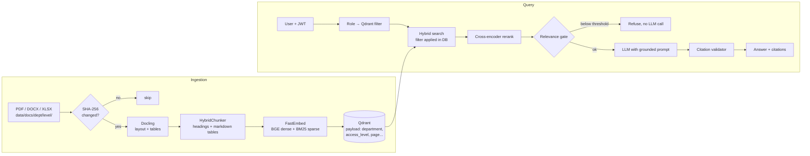

# Enterprise RAG with RBAC

A retrieval-augmented generation (RAG) system over internal company documents, where **what you can retrieve depends on who you are**. Access rules are enforced inside the vector database query, every answer cites its sources, and the system is measured against a 40-question golden set.

**Stack:** Python 3.12 · FastAPI · Docling · LlamaIndex · Qdrant (dense + BM25 hybrid) · FastEmbed cross-encoder reranker · any OpenAI-compatible LLM (default: `gpt-oss-120b` on Groq) · Ragas · Streamlit · pytest

## What it does

- **Parses PDF, DOCX and XLSX with Docling**, keeping headings and tables. Tables are serialised as markdown and never split from their header row.
- **Structure-aware chunking** (Docling HybridChunker, token-limited to the embedding model). Each chunk is prefixed with its document title and section headings and carries `department`, `access_level`, `source_file`, `page_number`, `section` and `doc_hash`.
- **Incremental indexing.** Each file is hashed with SHA-256: unchanged files are skipped, changed files have their old chunks deleted before re-insert, and deleted files are purged.
- **RBAC at the database level.** The user's role becomes a Qdrant filter applied inside both the dense and the sparse search, so unauthorised chunks never reach Python or the LLM.
- **Hybrid retrieval and reranking:** BGE-small dense vectors plus BM25 sparse vectors, fused, then re-scored by a cross-encoder.
- **Guardrails:**
  - A *relevance gate* refuses without calling the LLM when nothing relevant is found.
  - A grounded prompt requires `[source_file, p. X]` citations.
  - *Post-generation citation checking* strips citations to sources that weren't retrieved and replaces uncited answers with a refusal.
- **Evaluation:** retrieval metrics per mode, end-to-end answer, refusal and citation accuracy, plus Ragas metrics (faithfulness, answer relevancy, context precision, context recall) with `--ragas`.

## Architecture



### Access model

| Role | Public (all depts) | Internal | Confidential |
|---|---|---|---|
| employee | ✅ | own department | ❌ |
| manager | ✅ | all departments | own department |
| admin | ✅ | ✅ | ✅ |

The rule is written twice: as plain Python (`can_read`) and as a Qdrant filter (`qdrant_filter`). A test checks that the two agree for every role, department and level.

## Results

The evaluation set has 40 questions across 5 users: 24 answerable (8 deliberately reworded to avoid keyword overlap), 8 where the answer exists but the asker's role forbids it, and 8 that the documents can't answer. The corpus has 20 documents; 4 of them are distractors with similar wording and different facts. Full output is in [eval/RESULTS.md](eval/RESULTS.md).

**Retrieval** (top-5, no LLM):

| Mode | Hit rate@1 | Hit rate@5 | MRR | RBAC leakage | p50 latency |
|---|---|---|---|---|---|
| dense | 87.5% | 95.8% | 0.917 | 0.0% | 12 ms |
| hybrid | 95.8% | 95.8% | 0.958 | 0.0% | 16 ms |
| hybrid + rerank | 95.8% | 95.8% | 0.958 | 0.0% | ~650 ms (CPU) |

Hybrid search fixed the cases where dense search alone ranked a distractor first (support-ticket SLAs vs incident SLAs, procurement vs sales discounts). The reranker matches hybrid on hit rate here. Its main value is the relevance gate: it gives a calibrated score that separates "nothing relevant" (around −10) from real matches (above 0).

**End to end** (`hybrid + rerank`, LLM `openai/gpt-oss-120b` on Groq):

| Metric | Value |
|---|---|
| Answer accuracy (24 answerable) | **87.5%** (21/24) |
| Correct source cited | 87.5% |
| Refusal accuracy (8 restricted + 8 unanswerable) | **100%** (16/16) |
| RBAC leakage | **0%** |
| LLM calls skipped by the relevance gate | 9 of 40 |
| Latency p50 / p95 | 1.3 s / 2.2 s |
| Avg tokens per answered query | ~620 in / ~60 out |

The 3 misses are all from the reworded set. One is a retrieval miss (the "INR 20 lakh" question needs arithmetic). In the other two, the model was over-cautious: it refused when the right chunk was present but phrased differently.

**What evaluation changed.** The first end-to-end run scored 79.2%, and evaluation surfaced three problems that were fixed:

1. **Citation format.** `gpt-oss` cites with full-width brackets `【…】`, so the validator rejected correct, cited answers. Citations are now normalised before checking.
2. **Relevance gate threshold.** The −4 threshold blocked reworded questions. Measured reranker scores showed answerable and unanswerable questions overlap, so the gate became a cost filter only (threshold −8) and the grounded prompt makes the final call.
3. **Scorer.** The scorer treated "15 %" and "15%" as different answers.

## Quick start

```bash
# 1. Environment (Python 3.12; uv recommended)
uv venv --python 3.12 && uv pip install -e ".[dev,eval]"
cp .env.example .env        # add LLM_API_KEY (Groq free tier works)

# 2. Generate the synthetic company documents and index them
python scripts/generate_corpus.py
python scripts/ingest.py    # first run downloads Docling + embedding models

# 3. Run the API and UI
uvicorn app.api:app --reload
streamlit run ui/streamlit_app.py
```

Demo users: `priya` (engineering employee), `ananya` (sales employee), `rahul` (finance manager), `vikram` (HR manager) and `admin`. The password for all of them is `demo`.

```bash
# Tests: RBAC filter equivalence, leakage over the real index, incremental indexing, citation guardrails
pytest
# Evaluation
python eval/run_eval.py --retrieval-only   # no API key needed
python eval/run_eval.py                    # + end-to-end
python eval/run_eval.py --ragas            # + Ragas metrics
```

> Embedded Qdrant allows one process at a time. Stop the API before running `scripts/ingest.py`, the tests or the eval, or set `QDRANT_URL` to use a Qdrant server (see `docker-compose.yml`).

### API

| Method | Path | Who | Purpose |
|---|---|---|---|
| POST | `/auth/login` | anyone | Get a JWT for a demo user |
| GET | `/me` | user | Your role and which `department/level` you can read |
| POST | `/query` | user | `{"question", "mode"?}` → answer, citations, passages, timings, tokens |
| POST | `/ingest` | admin | Upload a file into a department and access level |
| POST | `/ingest/sync` | admin | Incremental re-sync of `data/docs` |
| GET | `/health` | anyone | Number of chunks indexed |

## Design decisions

- **Filter in the database, not after retrieval.** Post-filtering top-k results leaks information through what's missing, and returns too few results when most candidates are forbidden. Here Qdrant applies the filter inside both searches, so a user's top-k comes only from chunks they may read.
- **Labels come from the folder path** (`dept/level/file`). Access is visible and auditable in the file system, and moving a file re-labels it on the next sync.
- **LlamaIndex for indexing and retrieval, direct calls for generation.** LlamaIndex handles the Qdrant hybrid store and the retriever. The final LLM call and the citation checking are plain code, so every guardrail step is explicit and testable.
- **Relevance gate before the LLM.** If the best reranked chunk scores below a threshold, the system refuses immediately. That saves tokens and removes the chance of the model "helpfully" answering from unrelated context.
- **Citations are verified, not trusted.** The model's citations are parsed and checked against the retrieved set.
- **Local embeddings and reranker** (ONNX via FastEmbed): no embedding API cost, and documents never leave the machine during indexing.

## Limitations and next steps

- Docling doesn't report page numbers for Word files, so DOCX chunks cite `p. 1`. A fix is to cite section headings for DOCX.
- One reworded question ("who signs off on INR 20 lakh?") needs arithmetic to map onto the approval bands, and no retrieval mode ranks the right chunk first. Query rewriting could address it.
- The cross-encoder adds about 600 ms on CPU. Options are batching, a GPU, or a smaller reranker.
- Next: streaming answers, conversation memory, OCR for scanned PDFs, an SSO/OIDC identity provider instead of demo users, and evaluation on a larger, real-world corpus.

## Project layout

```
app/
  config.py      settings (.env)
  rbac.py        roles, can_read(), qdrant_filter()
  auth.py        JWT login
  ingest.py      Docling parsing, chunking, hashing, incremental sync
  store.py       Qdrant client, LlamaIndex index, embeddings, LLM
  retrieval.py   dense / hybrid / hybrid_rerank
  guardrails.py  prompt, refusal, citation validation
  rag.py         retrieve → gate → generate → validate
  api.py         FastAPI
ui/streamlit_app.py
scripts/generate_corpus.py, scripts/ingest.py
eval/golden.jsonl, eval/run_eval.py, eval/RESULTS.md
tests/
```

## License

MIT
